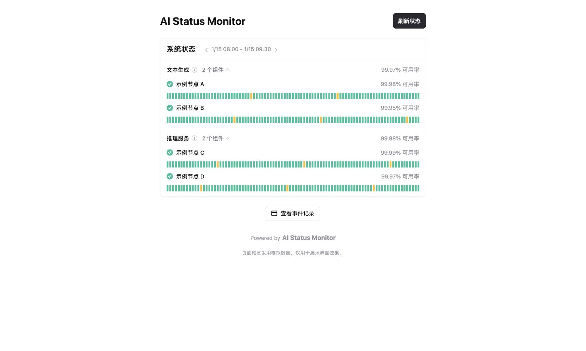

# AI Status Monitor

一个可自托管的 AI 模型接口状态监控服务。

项目会定时向配置的模型渠道发送真实请求，记录请求状态、响应耗时、端点网络延迟和历史记录，并提供一个可直接由 Nginx 代理的状态页面。

## 页面预览

> 以下界面使用模拟渠道和模拟状态数据，仅用于展示页面效果。



## 功能

- 支持 OpenAI、Anthropic 和 Gemini 协议渠道。
- 支持流式模型请求和真实回复验证。
- 支持随机问答检测，避免仅返回固定内容的假响应。
- 支持简单文本检测，例如只发送 `hi`。
- 支持请求超时、重试和并发控制。
- 支持渠道连续检测失败后的邮件、Telegram 告警和恢复通知。
- 支持 Telegram Bot 主动查询当前状态和指定时间范围的历史统计。
- 支持在容器内用 Chromium 生成状态页整页截图并发送到 Telegram。
- 支持端点 `HEAD/GET` 网络延迟检测。
- 支持本地 JSON 历史记录，默认保留 30 天。
- 提供状态首页、事件记录页和 JSON API。
- 不依赖数据库、Supabase 或管理后台。
- 可通过环境变量配置站点标题、品牌和页面显示方式。

## 快速部署

需要安装 Docker 和 Docker Compose。

```bash
cp .env.example .env
mkdir -p config data
cp config/providers.example.json config/providers.json
```

编辑 `config/providers.json`，填入实际渠道配置，然后启动：

```bash
docker compose up -d --build
```

服务默认只监听本机端口 `8099`：

```text
http://127.0.0.1:8099
```

推荐通过 Nginx 或其他反向代理对外提供访问，不建议直接暴露检测服务端口。

## 工作方式

```text
定时任务 -> 真实模型请求 -> JSON 历史记录 -> 状态页 / JSON API
                         \-> 连续失败计数 -> SMTP / Telegram 告警

Telegram Bot -> /status、/history -> 读取已有状态和历史
             \-> /screenshot -> 容器内 Chromium -> PNG -> Telegram
```

- 定时检测、Bot 查询和页面 API 使用同一份本地历史数据。
- `/status` 和 `/history` 不会额外请求模型。
- `/screenshot` 访问容器自身的状态页，不依赖第三方截图平台。
- Chromium 只在生成截图时启动，截图保存在内存中，发送后即释放。

## 渠道配置

示例配置位于 `config/providers.example.json`。真实配置文件为 `config/providers.json`，该文件包含 API key，不应提交到 Git 仓库。

基本配置示例：

```json
{
  "id": "example-openai",
  "name": "GPT Example",
  "type": "openai",
  "endpoint": "https://example.com/v1/responses",
  "model": "gpt-example",
  "apiKey": "replace-me",
  "checkMode": "challenge",
  "simplePrompt": "hi",
  "enabled": true,
  "isMaintenance": false,
  "requestHeaders": null,
  "metadata": null,
  "groupName": null
}
```

### 问答检测

```json
"checkMode": "challenge"
```

发送随机生成的分类或阅读理解问题，并验证模型返回的答案。未填写 `checkMode` 时默认使用此模式。

### 简单文本检测

```json
"checkMode": "simple",
"simplePrompt": "hi"
```

发送 `simplePrompt`，只要模型返回非空内容即可通过检测。`simplePrompt` 未填写时默认发送 `hi`。

### Claude Code 伪装检测（官方客户端校验）

```json
"checkMode": "claude-code"
```

针对只放行「官方 Claude Code 客户端」的 Claude Max 号池中继（上游报错
`relay_official_client_only: only official Claude Code clients are allowed`）：
检测请求会带上完整官方 CLI 请求头（`claude-cli/...` UA、`x-app: cli`、
`x-stainless-*`、`anthropic-beta`、`anthropic-dangerous-direct-browser-access`），
body 使用官方形状（`system` 提示词、`cache_control`、`metadata.user_id` 新版 JSON
格式、`max_tokens: 1024`、`temperature: 1`、`stream: true`）；收到 SSE
`message_start` 即判定通过并立刻断开，避免继续消耗上游 token。

只支持 `type: "anthropic"`；请求固定发往 `${endpoint 去掉 /v1/messages 后的根地址}/v1/messages?beta=true`。

### 生图检测

```json
{
  "checkMode": "image",
  "imagePrompt": "一只拉布拉多犬一直用前爪举着一块牌子，牌子上写着 \"JOJO Code\"",
  "imageSize": "1024x1024",
  "intervalSeconds": 3600,
  "timeoutMs": 240000,
  "degradedMs": 120000
}
```

向 `<endpoint 去掉 /responses 等后缀>/images/generations` 发送一次真实生图请求（`model` 即生图模型，例如 `gpt-image-2`），响应中必须包含 `b64_json` 或图片 `url` 才算成功。生图较慢，默认超时 240 秒、耗时超过 120 秒才标记为性能下降；超时不会重试，避免重复计费。

`intervalSeconds` 可为单个渠道单独指定检测间隔（15 秒到 24 小时）；不填时使用全局的 `CHECK_POLL_INTERVAL_SECONDS`。生图渠道通常配置为 `3600`（每小时一次），其曲线和“每小时检测”标签会独立成组展示，不与其他按分钟检测的渠道混排。

多个生图渠道串行检测，避免同时请求导致上游「无可用账号」；遇到 429/5xx 会间隔 3 秒、8 秒各重试一次，仍失败才记录异常。

4K 模型（`gpt-image-2-4k`）需要在渠道配置里显式设置 `imageSize` 为 4K 预设，例如 `3840x2160`（16:9）或 `2880x2880`（1:1）；不设置时上游默认只返回 1024x1024。单张 4K 图片约 6-7MB，图片保存在数据卷的 `data/images/` 下。

每次检测成功后会下载并保存**最近一张生图**（每个渠道只保留最新一张，覆盖写入 `data/images/<渠道 id>.png`，历史记录里不保存图片二进制）。状态页上点击该渠道历史条的任意一点即可弹出查看最近一张图；图片接口为 `GET /api/images/<渠道 id>`。


## 环境变量

### 检测参数

| 变量 | 默认值 | 说明 |
| --- | --- | --- |
| `CHECK_POLL_INTERVAL_SECONDS` | `60` | 检测间隔，单位为秒 |
| `CHECK_CONCURRENCY` | `5` | 同时检测的渠道数量 |
| `CHECK_TIMEOUT_MS` | `45000` | 单次请求超时时间 |
| `DEGRADED_THRESHOLD_MS` | `10000` | 超过该耗时标记为性能下降 |
| `HISTORY_RETENTION_DAYS` | `30` | 历史记录保留天数 |
| `API_HISTORY_POINTS` | `91` | API 返回的历史点数量 |

### 故障告警

当渠道连续出现 `failed`、`validation_failed` 或 `error` 达到阈值时，服务通过已配置的邮件和 Telegram 通道发送一次故障通知；渠道恢复到 `operational` 或 `degraded` 后发送一次恢复通知。`degraded` 表示响应较慢，不会单独触发故障告警。

| 变量 | 默认值 | 说明 |
| --- | --- | --- |
| `ALERT_CONSECUTIVE_FAILURES` | `3` | 连续失败多少次后发送告警通知 |
| `ALERT_EMAIL_TO` | `SMTP_USERNAME` | 收件人，可用逗号、分号或空格分隔多个地址 |
| `SMTP_HOST` | 空 | SMTP 服务器地址 |
| `SMTP_PORT` | `465` | SMTP 端口 |
| `SMTP_USERNAME` | 空 | SMTP 用户名 |
| `SMTP_PASSWORD` | 空 | SMTP 密码，只从运行时环境变量读取 |
| `SMTP_FROM` | `SMTP_USERNAME` | 发件地址 |
| `SMTP_FROM_NAME` | 空 | 发件人显示名称 |
| `SMTP_USE_TLS` | `true` | 是否启用 TLS；465 端口使用 SMTPS，其他端口使用 STARTTLS |
| `TELEGRAM_BOT_TOKEN` | 空 | Telegram BotFather 创建的机器人 Token |
| `TELEGRAM_CHAT_ID` | 空 | 接收通知的用户、群组或频道 ID |
| `TELEGRAM_MESSAGE_THREAD_ID` | 空 | 可选，Telegram 群组话题 ID |
| `TELEGRAM_COMMANDS_ENABLED` | `true` | 是否启用机器人查询命令 |
| `TELEGRAM_HISTORY_DEFAULT_HOURS` | `24` | `/history` 默认统计小时数 |
| `TELEGRAM_STATUS_URL` | 空 | 命令回复中附带的完整状态页地址 |
| `TELEGRAM_SCREENSHOT_URL` | `http://127.0.0.1:3000` | `/screenshot` 在容器内打开的状态页地址 |

不要将真实 SMTP 密码提交到 Git 仓库或写入公开配置文件。

Telegram 示例：

```dotenv
TELEGRAM_BOT_TOKEN=123456789:replace-with-your-token
TELEGRAM_CHAT_ID=-1001234567890
# TELEGRAM_MESSAGE_THREAD_ID=123
```

机器人必须已经加入目标群组或频道，并具有发送消息的权限。Bot Token 同样只能保存在服务器私有 `.env` 中。

机器人只响应 `TELEGRAM_CHAT_ID` 对应会话中的命令：

- `/status`：显示当前渠道状态和延迟。
- `/history`：显示最近 24 小时可用率、失败次数、延迟和趋势。
- `/history 1h`：显示最近 1 小时历史。
- `/history 7d`：显示最近 7 天历史，最长支持 30 天。
- `/screenshot`：在容器内渲染状态页并发送整页 PNG 截图。

### 页面截图

截图能力已经集成在项目镜像中，由 `puppeteer-core` 驱动容器内的 Chromium，并安装 Noto CJK 字体保证中文正常显示。截图时会等待页面数据和字体加载完成，自动展开模型分组，再以 PNG 图片上传到 Telegram。

启用截图后的镜像通常约为 `500 MB`，具体取决于基础镜像和软件包版本。Chromium 不会常驻运行；空闲时仍只有 Node.js 服务，生成截图时会短暂增加 CPU 和内存使用。Compose 使用 `init: true` 回收 Chromium 退出后的子进程。

### 页面显示

| 变量 | 默认值 | 说明 |
| --- | --- | --- |
| `SHOW_OVERALL_ALERT` | `false` | 是否显示首页整体异常提示框 |
| `DEFAULT_GROUPS_EXPANDED` | `true` | 页面加载时是否默认展开所有分组 |
| `SITE_TITLE` | `AI Status Monitor` | 浏览器标题 |
| `SITE_BRAND` | `AI Status Monitor` | 页头和面包屑品牌 |
| `SITE_FOOTER_BRAND` | `AI Status Monitor` | 页脚品牌 |

例如：

```dotenv
SITE_TITLE=My AI Status
SITE_BRAND=My AI Status
SITE_FOOTER_BRAND=My AI Status
SHOW_OVERALL_ALERT=false
DEFAULT_GROUPS_EXPANDED=true
```

页面品牌只通过环境变量配置，不需要修改源代码。`.env` 已被 Git 忽略，不应提交到公开仓库。

## API 接口

| 方法 | 路径 | 说明 |
| --- | --- | --- |
| `GET` | `/` | 状态首页 |
| `GET` | `/history` | 历史事件页面 |
| `GET` | `/health` | 服务健康检查 |
| `GET` | `/api/status` | 前端使用的状态数据 |
| `GET` | `/api/v1/status` | 原始检测结果，便于其他页面或系统集成 |

## 数据和安全

- `config/providers.json` 包含 API key，必须限制文件权限。
- `data/history.json` 保存检测历史，不应公开访问。
- Docker Compose 已将配置目录只读挂载到容器。
- 建议将 `.env`、`config/providers.json` 和 `data/` 保持在 Git 忽略范围内。
- 项目日志不会输出 API key 或完整请求内容。
- Telegram Bot 只处理配置的 `TELEGRAM_CHAT_ID`，其他会话中的命令会被忽略。
- SMTP 密码和 Telegram Bot Token 只能存放在未提交的 `.env` 中。

## 常见问题

### Telegram 命令没有响应

确认机器人已经加入目标群组并具有发送消息权限，`TELEGRAM_CHAT_ID` 与目标会话一致，且没有为同一个 Bot 配置其他 `getUpdates` 消费者或 Webhook。

### 截图生成失败

先检查容器日志：

```bash
docker compose logs --tail=100 ai-status-monitor
```

默认截图地址为容器自身的 `http://127.0.0.1:3000`。如果修改了端口或页面路径，需要同步调整 `TELEGRAM_SCREENSHOT_URL`。

### 修改配置后没有生效

环境变量由 Docker Compose 在创建容器时注入，修改 `.env` 后需要重建容器：

```bash
docker compose up -d
```

## 开发和测试

安装依赖：

```bash
npm install
```

运行测试：

```bash
npm test
```

项目包含配置解析、挑战生成、请求模式、重试逻辑、历史存储、状态转换和页面配置测试。

## 开源许可

本项目采用 MIT License。检测协议适配逻辑参考了 MIT 许可项目 `BingZi-233/check-cx`，相关版权和许可信息见 `LICENSE`。
